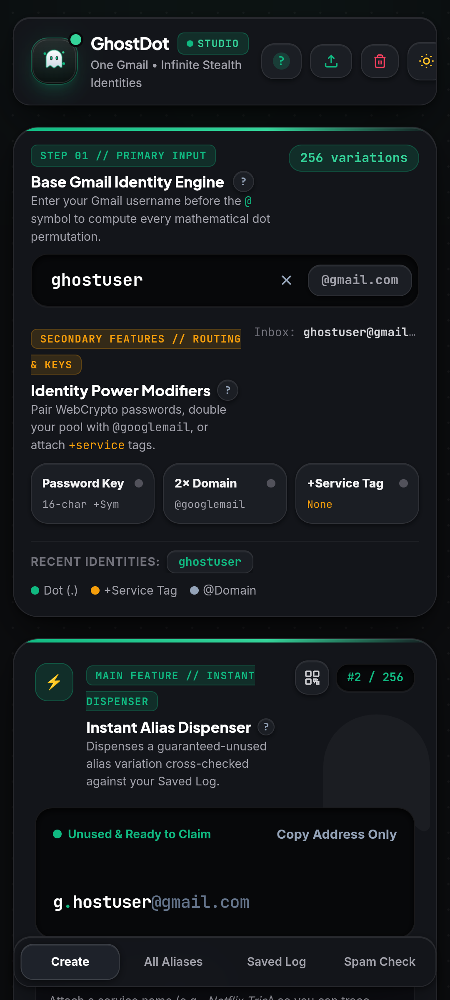
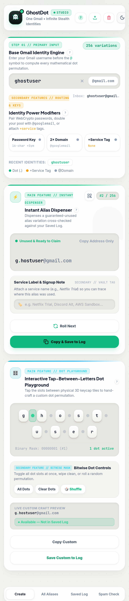

<div align="center">

<!-- HERO LOGO / EMBLEM -->


# 👻 GHOSTDOT // STUDIO `v5.2`

### **One Gmail. Infinite Identities.**
*A tactile, 100% offline email sub-addressing synthesizer, cryptographic credential dispenser, local identity vault, and spam forensics engine—available as an instant Web Studio and a native Android Gradle application.*

[](https://deadly-ghost311.github.io/ghostdot-studio/)
[](https://github.com/deadly-ghost311/ghostdot-studio/releases/latest)
[](#-building-the-android-apk--aab-gradle)
[](LICENSE)

<br />

-3DDC84?style=flat-square&logo=android)

-F7DF1E?style=flat-square&logo=javascript&logoColor=black)

-8B5CF6?style=flat-square)
-10B981?style=flat-square&logo=shield)

<p align="center">
  <a href="#-dual-platform-monorepo-overview">Overview</a> •
  <a href="#-visual-showcase--screenshots">Screenshots</a> •
  <a href="#-core-feature-matrix">Features</a> •
  <a href="#-repository-structure">Repo Structure</a> •
  <a href="#-building-the-android-apk--aab-gradle">Gradle Build</a> •
  <a href="#️-under-the-hood-engineering-highlights">Engineering</a>
</p>

</div>

---

## 🌐 Dual-Platform Monorepo Overview

This repository houses **both** distribution targets of **GhostDot Studio** in a unified codebase:

| Target Platform | Source Path | Description |
| :--- | :--- | :--- |
| **1. Standalone Web Studio** | `/index.html` | Zero-build single-file web application deployed directly to GitHub Pages. Runs in any desktop or mobile browser. |
| **2. Android Native App (Gradle)** | `/app` & `/gradle` | Complete Android Studio / Gradle project wrapping the studio engine inside a hardware-accelerated Android `WebView` with native haptics, DOM storage persistence, and offline asset packaging. |

---

## ⚡ Why GhostDot Studio?

Every time you hand out your primary email address (`alexsmith@gmail.com`), you give away a permanent tracking identifier across data brokers, newsletter lists, and potential database breaches.

Gmail natively supports three powerful normalization rules that route directly to your real inbox without creating a new account:
1. **Canonical Dot Normalization:** Dots (`.`) before the `@` are ignored (`a.lex.smith@gmail.com` === `alexsmith@gmail.com`). A username of length $N$ yields **$2^{N-1}$ unique dot permutations**.
2. **RFC 5233 Sub-Addressing (`+tag`):** Appending `+service` before `@` (`alex.smith+netflix@gmail.com`) routes straight to your inbox while tagging the exact sender.
3. **Legacy Domain Equivalence (`2×`):** `@googlemail.com` and `@gmail.com` resolve to the exact same mailbox, doubling your total alias pool.

```text
  [ a.lex.s.mith+netflix@googlemail.com ] ──┐
  [ alex.smith+discord@gmail.com        ] ──┼──► 📥 REAL INBOX: alexsmith@gmail.com
  [ a.l.e.x.s.m.i.t.h@gmail.com         ] ──┘
```

---

## 📸 Visual Showcase & Screenshots

> 💡 *Replace the placeholder paths below with your actual screenshots inside `/assets/screenshots/`.*

<div align="center">

| 🖥️ **Desktop Web Studio (Obsidian Dark)** | ☀️ **Desktop Web Studio (Warm Ceramic Light)** |
| :---: | :---: |
|  |  |
| *Dual-panel Instant Dispenser & Interactive Keycap Dot Playground* | *High-contrast Alabaster Ceramic theme for daylight legibility* |

</div>

### 📱 Android APK Screenshots

<div align="center">
  
  
  
  
</div>

---

## 🧩 Core Feature Matrix

### 1. 🎛️ Dual-Engine Creation Studio
* **Instant Alias Dispenser:** Dispenses a guaranteed-unused alias variation in one tap, cross-checking your Saved Vault to prevent duplicate assignments.
* **Interactive "Tap-Between-Letters" Dot Playground:** Renders every character of your base username as a physical keycap tile with interactive dot slots (`•`) between letters. Toggle dots manually, randomize bitmasks, or apply all/no dots while watching a real-time **Vault Collision Indicator** (`● Available` vs `● Already Saved`).
* **Color-Coded Email Anatomy:** Highlights **`.dots` in Emerald (`#10B981`)**, **`+tags` in Warm Amber (`#F59E0B`)**, and **`@domains` in Slate** for instant visual parsing.

### 2. 🔐 Cryptographic Password Pairing
* **True CSPRNG Entropy:** Powered by `window.crypto.getRandomValues()`.
* **Customizable Specs:** Toggle between `12`, `16`, and `24` character keys, enable/disable special symbols (`!@#$%^&*`), and copy `email:password` pairs in a single tap.

### 3. 📲 Offline ISO/IEC 18004 QR Code Transfer Engine
* **Zero External APIs:** Encodes scannable QR codes 100% offline in pure JavaScript—your credentials never touch a third-party server.
* **4 Payload Modes:** Switch on the fly between `Email Only`, `Email + Pass`, `Pass Only`, and `vCard / Note`.
* **1024×1024 `.PNG` Export:** Renders vector modules onto an HTML5 `<canvas>` with a 4-module quiet zone for instant saving.

### 4. 🗄️ Local Identity Vault & Round-Trip Sync Hub
* **Inline CRUD Management:** Cycle status pills (`Active` → `Trial` → `VIP` → `Burned`), edit notes and paired passwords inline, or filter by status and search terms.
* **Round-Trip `.CSV`, `.JSON`, & `.TXT` Sync:** Export your vault to edit in Excel or Google Sheets, then re-import via file upload or clipboard paste with a live **`+New` vs `~Modify` diff preview** before merging.
* **Protected Data Purge (`Type DELETE` Gate):** Single deletions offer a **7-second Undo Toast**, while bulk purges and Factory Resets require passing an explicit `DELETE` verification modal with a 1-click emergency `.JSON` backup button.

### 5. 🛡️ Spam Forensics & Gmail Auto-Trash `.XML` Generator
* **Reverse Leak Decoder:** Paste any suspicious alias from your inbox to extract its canonical Gmail address, `+service` tag, exact bitwise dot-permutation index (`#0` to `#2^(N-1)`), and Saved Vault record.
* **1-Click `.XML` Filter Export:** Generates a standards-compliant Gmail Atom `.xml` filter file that automatically routes all future emails sent to that burned alias straight to Trash.

---

## 📂 Repository Structure

```text
ghostdot-studio/
├── index.html                          # 🌐 Standalone Single-File Web Studio (GitHub Pages root)
├── README.md                           # 📖 Project documentation
├── LICENSE                             # ⚖️ MIT License
├── build.gradle / build.gradle.kts     # ⚙️ Root Gradle configuration
├── settings.gradle / settings.gradle.kts
├── gradlew & gradlew.bat               # 🚀 Gradle Wrapper scripts
├── gradle/
│   └── wrapper/                        # 📦 Gradle Wrapper JAR & properties
├── assets/
│   └── screenshots/                    # 📸 README & Play Store showcase images
└── app/                                # 🤖 Android Application Module
    ├── build.gradle / build.gradle.kts # 📱 Android app build config & asset sync task
    └── src/main/
        ├── AndroidManifest.xml         # 🛡️ App manifest & configuration
        ├── assets/
        │   └── index.html              # ⚡ Bundled offline studio asset for WebView
        ├── java/.../MainActivity.*     # 🖥️ Native WebView host, bridge & back-navigation
        └── res/                        # 🎨 Adaptive launcher icons, themes & drawables
```

---

## 🛠️ Building the Android APK & AAB (Gradle)

### Prerequisites
* **JDK 17+**
* **Android Studio Ladybug (or newer)** OR Android SDK Command-Line Tools

### 1. Clone the Repository
```bash
git clone [https://github.com/deadly-ghost311/ghostdot-studio.git](https://github.com/deadly-ghost311/ghostdot-studio.git)
cd ghostdot-studio
```

### 2. Build Debug APK via Gradle Wrapper
Run the included Gradle wrapper from the project root:
```bash
# Linux / macOS
chmod +x gradlew
./gradlew assembleDebug

# Windows (PowerShell / CMD)
.\gradlew.bat assembleDebug
```
> 📍 **Output APK:** `app/build/outputs/apk/debug/app-debug.apk`

### 3. Build Signed Release APK / Play Store Bundle (`.AAB`)
```bash
# Generate Release APK
./gradlew assembleRelease

# Generate Google Play Android App Bundle (.aab)
./gradlew bundleRelease
```
> 📍 **Output AAB:** `app/build/outputs/bundle/release/app-release.aab`

### 4. Run as a Standalone Web App (Zero Build)
If you only want to run or modify the web version without Gradle:
```bash
# Simply open index.html in any modern browser
xdg-open index.html   # Linux
start index.html      # Windows
open index.html       # macOS
```

---

## ⚙️ Under the Hood: Engineering Highlights

| Subsystem | Implementation Detail |
| :--- | :--- |
| **Bitwise Permutation Generator** | Maps every integer $i \in [0, 2^{N-1}-1]$ to a binary bitmask where bit $k$ determines whether a dot is inserted after character $k$. Includes an automatic **15-character exponential safety guard** ($>16,384$ combinations) that caps DOM rendering at $5,000$ nodes while preserving full-stream `.CSV`/`.TXT` exports. |
| **Pure-JS ISO/IEC 18004 QR Encoder** | Implements Galois Field $GF(2^8)$ log/antilog tables (primitive polynomial $x^8 + x^4 + x^3 + x^2 + 1$, `0x11D`), Reed-Solomon error-correction block interleaving, Finder/Alignment/Timing patterns, BCH(15,5) format strings (`0x5412` mask), and dynamic 8-mask penalty evaluation. |
| **Android WebView Integration** | Configured with `domStorageEnabled = true` for persistent `localStorage` vault custody, hardware acceleration, safe-area inset handling, and native tactile vibration hooks (`navigator.vibrate(12)`). |

---

## 🔒 Privacy & Google Play Data Safety Compliance

* **Zero Network Transmission:** GhostDot Studio never transmits your base email, generated aliases, or passwords over the network.
* **Zero Analytics or Trackers:** No Firebase Analytics, no advertising IDs, and no third-party telemetry SDKs.
* **100% Local Custody:** All vault records reside strictly on-device under the `ghostdot_v52_*` storage namespace, with instant `.JSON`/`.CSV` export and verified `DELETE` factory-wipe controls.

> **Disclaimer:** GhostDot Studio is an independent email privacy and inbox organization utility and is not affiliated with, endorsed by, or sponsored by Google LLC.

---

## 📄 License

Distributed under the **MIT License**. See [`LICENSE`](LICENSE) for full details.

<div align="center">
  <br />
  <b>Crafted with precision by <a href="https://github.com/deadly-ghost311">@deadly-ghost311</a></b><br />
  <sub><i>"One Gmail. Infinite Identities."</i></sub>
</div>
